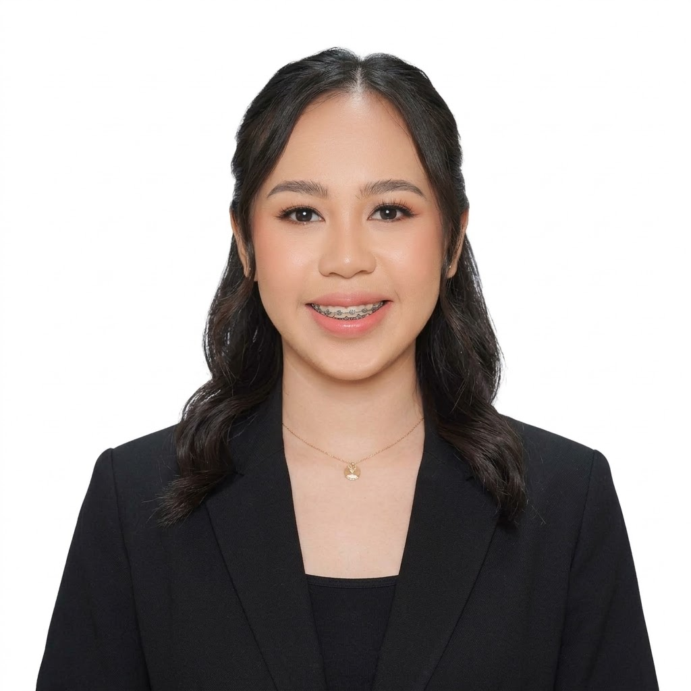

# 💙 Jasmine Padillo Panague

### BSN Student | Future Registered Nurse

---

## 🩵 About Me

Hello! I'm **Jasmine Padillo Panague**, a 21-year-old Bachelor of Science in Nursing student from **BSN 4D**.

I am passionate about learning, exploring new ideas, and developing my skills both academically and creatively. As a nursing student, I also enjoy discovering how technology can be used to improve learning, communication, organization, and everyday tasks.

This repository serves as my **academic portfolio for GE 4120**, featuring my laboratory activities, creative outputs, presentations, projects, and learning experiences throughout the course.

## 🪪 Academic Profile

| Details | Information |
|:---|:---|
| **Name** | Jasmine Padillo Panague |
| **Course Code** | GE 4120 |
| **Program** | Bachelor of Science in Nursing |
| **Year Level** | 4th Year |
| **Semester** | 1st Semester |
| **Section** | BSN 4D |

---

## 🗂️ Laboratory Activities

### 🩵 Activity 1: Presentation Design Principles
Explores the fundamental principles of creating effective and organized presentations, including proper layout, visual hierarchy, consistency, and presentation design.

### 🩵 Activity 2: Color Palette and Typography
Focuses on understanding color combinations and typography in digital design. It explores how appropriate colors and fonts improve readability, visual appeal, and overall design consistency.

### 🩵 Activity 3: Social Media Infographics and Mini Project Documentation
Involves creating informative and engaging social media infographics and documenting a mini project. It highlights the importance of visual communication, creativity, and presenting information effectively.

---

## ✨ Learning Goals

- 💻 Enhance my digital literacy and technological skills.
- 🎨 Explore creativity and improve visual design abilities.
- 📊 Develop skills in organizing, analyzing, and presenting information.
- 🤝 Strengthen communication and collaboration skills.
- 🌱 Discover innovative ways to integrate technology into academic and professional nursing practice.

---

## 🌸 A Little Inspiration

### "Dream big, stay curious, and keep growing."

*Every experience is a stepping stone toward becoming the person and professional I aspire to be.*

**Thank you for visiting my little corner of GitHub! ♡**

